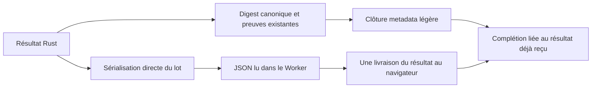

# Transport de présentation navigateur — 18 novembre 2026

Suite de [l'audit Verifier](../service-replay-audit-2026-11-16/README.md) et du
[routage des versions retenues](../signed-compact-replay-2026-11-16/README.md).
Suivi : [framework430](https://github.com/loicbelec/pitgun/issues/430),
[game315](https://github.com/loicbelec/pitgun-game/issues/315).
**Candidat local opt-in, aucun déploiement ni runtime distribué remplacé.**

## Réduction des copies

Le chemin de présentation conserve tous les paquets, frames, canaux et valeurs.
Il sérialise le lot natif emprunté directement, puis déplace son résultat
terminal dans le handle. Il évite l'arbre `serde_json::Value` intermédiaire et
la copie complète conservée avant sérialisation.

Une nouvelle fonction `complete_experimental_controlled_racing_metadata_json`
consomme ce même handle de présentation, après le lot terminal seulement :

- schéma `pitgun.racing-control-metadata/v1`, même handle ;
- même `canonical_result_digest`, calculé par la fonction native existante ;
- même journal, `native_evidence` et, si signé, `service_evidence` ;
- absence de `result`, déjà livré dans le lot terminal.

L'ancienne clôture complète reste disponible. Les mêmes gardes interdisent
de mélanger le replay compact et la présentation, de clore avant la fin et de
réutiliser un handle consommé. Validation des propositions, horloges,
idempotence et calculs du Solver sont inchangés.

Le host réutilise l'objet terminal déjà reçu ; il lie la clôture à son handle
et sa séquence avant de retrouver la forme de complétion existante. La détection
contrôle l'export WASM réel, pas seulement le wrapper d'un bridge JS plus récent.



## Précision : une expérience rejetée

La première sérialisation directe écrivait les `f32` sous leur forme courte.
Une distance devenait `0.3423208` au lieu de `0.3423207998275757` après lecture
JavaScript. Les preuves natives étaient identiques mais les valeurs de
présentation différaient : la variante `9d078a1d…` est **rejetée**, et ses mesures
privées ne constituent pas l'acceptation.

Le formatter retenu écrit les `f32` après élargissement exact en `f64`, comme
l'ancien arbre Value. Il ne modifie aucun type/serializer du contrat télémétrique
global. Un test compare toutes les valeurs JSON décodées de chaque lot d'une
simulation de cinq tours, y compris son résultat terminal, avec préfixe
présent/absent. Un autre couvre zéro négatif, subnormal, bornes et non-finis.
Aucun epsilon, arrondi ou rééchantillonnage ajouté.

## Mesure finale retenue

Trois paires alternées, Chrome157.0.8103.79 froid isolé, Apple M4 Pro, Darwin25.5,
sans builds/tests concurrents. Monza53, dix voitures,5Hz : mêmes entrée
physique, seed, actions et preuves attendues. Nouveau contexte de référence
lié au nouveau binaire, jamais une ancienne signature renommée.

| Mesure | Présentation précédente | Candidat corrigé |
| --- | ---: | ---: |
| Temps médian du chemin Worker |16,71s |13,25s |
| Plage des trois passages |16,58–16,79s |13,19–13,28s |
| JSON cumulé, unités UTF-16 |297 519 810 |227 882 879 |
| Clôture seule, unités UTF-16 |69 641 761 |4 830 |
| Mémoire linéaire WASM maximale observée |1 464,81Mio |1 339,56Mio |
| Médiane des pics RSS Chrome cumulés |2 848,27Mio |2 669,88Mio |

Temps réduit de20,75%, mémoire linéaire de125,25Mio (8,55%). Le RSS médian baisse
d'environ6,3% sur cette petite série finale ; des essais provisoires ont varié
davantage. Le navigateur reste lourd : aucune acceptation mémoire générale.
RSS échantillonné à500ms incluant pages partagées/GPU, sans GC forcé, distinct de
l'empreinte privée et d'un maximum garanti. Ce profil ne comprend ni rendu,
archive, stockage, carrière, publication ni admission aux services.

Les six runs ont le même digest complet `6227e035…657411`, les mêmes preuves et
les mêmes observations/reçus. Le nouveau `complete` garde environ2,8s de travail
de hash/projection malgré sa petite réponse. Les appels ABI incluent leur
sérialisation ; les temps `receive` et ABI se recouvrent.

Référence de performance : prototype local `cb24…` en présentation complète,
pas le runtime07 actuellement déployé. Aucun pourcentage VPS ou mobile déduit.
[Résumé et identités](summary.json) · [Manifest](candidate-manifest.json) ·
[19 contrôles signés](signed-checks.json).
Les six profils et la recette de reprise sont conservés dans le dépôt jeu,
`docs/qa/browser-completion-2026-11-18/`.

## Qualification

- Contrat générique :100 tests ; simulateur :111 tests, dont observations,
  reçus, journal, digest et preuves pour keep/pit/timeout, limites, cycles de vie
  et parité du transport JSON.
- Clippy strict des bibliothèques et `cargo fmt --all -- --check` passent.
  Clippy `--all-targets` est bloqué par quatre usages préexistants de `3.14`
  (`approx_constant`) dans les tests de `pitgun-contract/src/frame.rs`.
- Jeu :744 tests, lint sans erreur et build complet réussis. Deux avertissements
  ESLint générés préexistants et les avertissements de taille de bundle restent.
- Chrome/IndexedDB isolé : GP53 interrompu après reçu durable, reprise sans
  rappeler le décisionnaire, réouverture terminée avec journal inchangé et même
  digest/preuves. Une décision fraîche au total, trois Workers terminés.
- Authority/Verifier HTTP jetables :19 contrôles sur le candidat final.
  Keep/pit/timeout et Monza/Silverstone/Monaco, ancien runtime vérifiable,
  refus des falsifications/signatures invalides/mauvais pins et reprise après
  indisponibilité d'artefact. Clé éphémère supprimée ; aucun LLM, aucune
  carrière/récompense/publication dans cette recette.

```sh
node scripts/qualify-signed-service-replay.mjs NEW_WASM NEW_BRIDGE OLD_WASM OLD_BRIDGE NEW_PRIVATE_OUTPUT_DIR metadata
```

Le dernier paramètre omis conserve `full`. Les anciens artefacts gardent leur
ancienne API. Le fichier privé destiné au probe est normalisé avec le résultat
terminal, comme dans le navigateur ; cela n'ajoute pas `result` à l'ABI metadata.

## Limites et prochaine livraison

Les observations/reçus utilisent leur **nouveau contexte de runtime** : aucune
ancienne signature n'est réattribuée. Le résultat et le résumé télémétrique
correspondent exactement à la référence historique.

`canonical_result_digest` matérialise encore son arbre canonique. Le dernier
lot transporte encore le résultat complet ; frames progressives et historique
complet coexistent. Ce travail ne résout pas tout le pic mémoire et ne prouve
pas un défaut du runtime générique. Les appels ABI incluent le JSON ; ils ne
mesurent pas les seuls calculs physiques.

L'activation en carrière nécessite l'admission du nouveau couple WASM/bridge,
sa rétention avec les anciens couples et le Verifier compact, puis une recette
carrière réelle de reprise, récompense/publication unique et HQ/archives/Compare.
Le journal refuse toujours un autre digest de bridge : ne pas remplacer celui
d'une carrière épinglée. Le transport full est un repli du nouveau binaire ;
un rollback complet conserve tous les couples déjà admis.

Le host jeu réalise encore un `JSON.stringify`/`JSON.parse` complet entre le
contrôleur et l'adaptateur. Compression d'archive, stockage et rendu restent à
profiler séparément. File durable et exécuteur distant sont des chantiers
distincts ; aucune clé n'est déplacée hors de la zone de confiance.
