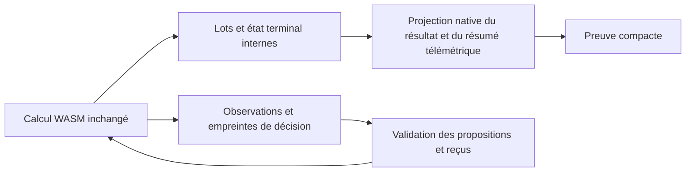

# Replay compact — prototype local du 16 novembre 2026

Suite de l'[audit par phases](../service-replay-audit-2026-11-16/README.md), #434.
**Candidat expérimental : aucun runtime distribué remplacé, aucune admission
Authority, aucun service staging/production changé.**

## Résultat mesuré

Monza53, dix voitures,5Hz, physique/entrées/seed identiques. Les deux chemins
utilisent le **même nouveau binaire**, le même catalogue1.8.1 et le même historique
de référence. Node22.23.5 Linuxarm64, une CPU,3GiB, old-space512MiB, sans réseau.
Les mesures de performance sont séquentielles, avec deux sessions par processus.

| Mesure | Transport de présentation | Transport de replay |
| --- | ---: | ---: |
| Première session |84,47s |14,75s |
| Session suivante, même module |17,47s |9,92s |
| JSON cumulé traversant l'ABI par course |297 519 810 octets |15 268 octets |
| High-water RSS, maximum des deux sessions |2 072 820KiB |732 968KiB |
| GC observé première session, inclus dans le temps |66,24s |4,15s |
| Réponse finale de l'adaptateur |2 448 octets |2 448 octets |

Gain observé première session :82,5% ; RSS de processus réduit de64,6%, soit
environ1,98GiB contre716MiB. Un contrôle avec l'adaptateur compact autonome,
sans instrumentation, termine en15,08s, démarrage Docker inclus. Tous les replays
retrouvent exactement le résultat et le résumé télémétrique de référence.

Ce sont des mesures locales sur un cas, pas une promesse de latence VPS ni une
mesure du navigateur. Les protocoles de cinq tours Silverstone et Monaco ci-dessous
qualifient la correction fonctionnelle, pas ces gains sur un GP complet.

[Résumé](summary.json) · [Présentation](presentation-profile.json) ·
[Compact](compact-profile.json) · [Identités](candidate-manifest.json).

## Où les matérialisations disparaissent

L'ancien transport reste disponible, sans changement de format. Un nouveau
transport de replay opt-in partage le même `start`, moteur `advance`, canal
d'observations et validation `propose` :

1. Pour un lot ordinaire, le moteur avance normalement, mais l'export retourne
   seulement un acquittement borné. Les trajectoires et frames ne deviennent pas
   une arborescence `serde_json::Value` puis une chaîne que Node jettera.
2. À la fin, l'export emprunte le `RaceOutput` du lot terminal pour appeler
   **la fonction existante** `RacingRunEvidenceV1::from_race_output`. Il évite de
   cloner ce résultat complet dans la session de transport et de sérialiser ce
   résultat dans le dernier lot.
3. Le nouvel export `complete` envoie uniquement `native_evidence`, puis libère
   la session. Il ne renvoie pas une deuxième copie des trajectoires/frames,
   le dump du journal ou le digest du résultat de présentation complet.

Le solveur, le Hz, les pneus, les thermiques et les points du circuit sont
inchangés. Les frames/trajectoires sont encore calculées et construites en
interne : ce premier prototype supprime surtout leurs clones, matérialisations
JSON et transferts inutiles pour la vérification. Il ne constitue pas encore un
solveur sans télémétrie, ni un export spécialisé pour l'affichage du jeu.

## Pourquoi la vérification garde ses contrôles

- L'adaptateur expérimental régénère chaque observation et compare son empreinte
  à l'historique fourni. Chaque proposition passe dans le validateur natif
  existant ; le reçu régénéré est comparé exactement au reçu enregistré.
- Il refuse toute décision manquante, supplémentaire ou réordonnée. Il ne
  demande pas au client de fournir la preuve compacte à accepter : il la recalcule.
- La projection finale utilise les mêmes frames et la même fonction de résumé.
  Le résultat métier et `telemetry_summary` restent les mêmes entrées de preuve.
- `canonical_result_digest` du gros `RaceOutput` était un contrôle local de sortie
  de présentation, pas le `output_digest` du résultat métier lié au reçu signé.
  Le prototype omet seulement le premier dans son chemin replay. Les contrôles
  du second, du résumé télémétrique, du contrat final et de l'historique restent
  dans `verify_service_with_replay`, sans modification.
- Signatures, audience, validité, modèle, politique, catalogue, entrées canoniques
  et identité du runtime restent vérifiés par le Verifier Rust existant. Les16
  tests existants passent. Le prototype n'est toutefois **pas encore raccordé à
  une nouvelle admission signée/HTTP** : les contrôles de l'adaptateur sont hors
  ligne et ne sont pas présentés comme une nouvelle exécution VERIFIED.
- Une session choisit son transport au premier pull. Mélanger les exports est
  refusé sans avancer le moteur ; compléter trop tôt échoue ; terminer consomme
  le handle. Les limites de sessions, entrées et soumissions restent en place.

La solidité démontrée correspond au contrat actuel : résultat métier, résumé
télémétrique et décisions appliquées. Ce changement n'étend pas la preuve à une
attestation exhaustive de chaque donnée de présentation.

## Identités et conservation des preuves

Le candidat WASM est `cb24d7f0bf474cd88eb3e05e828690438972a7f40d7875e6ac3bc2bb3f103451` ;
son bridge est `8148432845163d31f23fb1c2fe15defe1f49763d9dc51f18f06122a66e4f773c`.
Le runtime07 et son bridge1de conservés dans le jeu ne sont pas remplacés.

La préparation ne colle pas une ancienne signature sur ce nouveau binaire :
elle crée un contexte offline distinct et régénère les reçus sous le nouveau
runtime, avec un contrôleur de référence appliquant les mêmes actions. Le GP
conserve ses entrées physiques et retrouve le résultat/résumé de l'ancienne
preuve QA, digest `ac2ee9ed020a0a4f5595b7e4cc3ba99979a43ce50397f7af5e3b566b11696976`.
Il n'y a ni nouvelle inférence Gemini ni attribution Gemini pour ce candidat.

L'adaptateur compact refuse runtime07 comme capacité indisponible, sans repli
silencieux. Les preuves admises pour07 gardent leur ancien chemin. Une intégration
future devra enregistrer le nouveau runtime, le bridge et l'identité du nouvel
adaptateur côté Verifier ; elle ne découle pas d'une simple reconstruction locale.

## Recettes exécutées

- 108 tests bibliothèque Racing Simulator,16 tests bibliothèque Verifier,
  Clippy `-D warnings`, formatage global, build WASM release/locked et génération
  bindgen0.2.106 passent. Les scripts Node passent le contrôle syntaxique.
- Le test natif de transport compare intégralement observations/empreintes,
  reçus et preuves pour Keep, arrêt Hard et fallback timeout. Il vérifie aussi
  gel de l'observation, refus invalide, retry idempotent et cycle des handles.
- 33 cas Node22 hors ligne :11 sur chacun de Monza, Silverstone et Monaco, cinq
  tours/une voiture avec trois fenêtres et échéances. Présentation/compact ont
  la même preuve ; historique absent/extra/réordonné, mauvaise observation,
  mauvais reçu/run, décision tardive, pneu interdit et mauvais pin sont refusés.
- Le GP complet ci-dessus passe dans les deux transports, puis dans l'adaptateur
  compact autonome. Les tests courts ne remplacent pas une carrière ou les GP
  complets des autres circuits. L'ancienne capacité est explicitement refusée.

[Monza](protocol-checks.json) · [Silverstone](silverstone-checks.json) ·
[Monaco](monaco-checks.json) · [Runtime ancien](legacy-capability.json).

Outils opérateur, sans nouvelle dépendance :

- `scripts/prepare-compact-replay-candidate.mjs PAYLOAD WASM BRIDGE OUTPUT [LEGACY_EXPECTED]`
  prépare un historique offline distinct, refuse les sidecars signés et peut
  comparer la preuve à une référence ancienne. Les entrées restent privées.
- `scripts/profile-service-replay.mjs PAYLOAD EXPECTED WASM BRIDGE WASM_SHA BRIDGE_SHA REPEATS presentation|replay`
  mesure les deux chemins avec le même candidat.
- `scripts/check-compact-replay-adapter.mjs PAYLOAD EXPECTED WASM BRIDGE COMPACT_ADAPTER STOCK_ADAPTER`
  teste les rejets sur une fixture courte à plusieurs fenêtres.
- `services/pitgun-verifier/wasm-service-replay-compact.mjs` est expérimental et
  n'est ni copié par le Dockerfile ni sélectionné par `WasmServiceReplay`.

Les artefacts et entrées complets restent dans le dossier privé
`.maintenance/compact-replay-2026-11-16.local`. Les rapports publics ne contiennent
pas de signature, nonce, clé ou historique de joueur.

## Suite bornée

Qualifier d'autres distances/plateaux et l'admission signée du nouveau candidat,
puis définir le routage explicite des anciens/nouveaux runtimes et le repli de
release avant activation. La confirmation d'exploitation se fera dans la recette
staging habituelle ; une campagne VPS préalable n'est pas requise pour avancer
sur les expériences locales. La réutilisation bornée du moteur et la file durable
restent des chantiers distincts. Le jeu en staging reste disponible pour sa recette.
