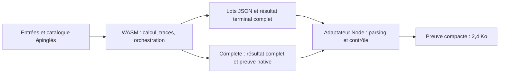

# Audit local du replay service — 16 novembre 2026

Première tranche de [#434](https://github.com/loicbelec/pitgun/issues/434).
Branche `perf/service-replay-phase-audit`, base `7aae5fc`.
**Mesures locales uniquement ; aucun déploiement ni modification de physique.**

## Conclusion bornée

Le replay exact fonctionne, mais le chemin de vérification fabrique et transfère
un résultat très volumineux avant d'en extraire une preuve compacte. Sur ce cas
arm64, le premier passage subit surtout un épisode de GC pendant le lot terminal.
Le même moteur réutilisé est beaucoup plus rapide. Les chiffres ne permettent
pas de conclure que le framework entier ou le solveur physique sont suboptimaux,
ni d'expliquer intégralement les326–338s déjà observées sur le VPS amd64.

## Cas et environnement

- Vraie preuve QA Gemini déjà VERIFIED et publiée lors de la recette du15 novembre :
  Monza53, dix voitures,5Hz, une action enregistrée Keep plan. Le replay est hors
  ligne, sans nouvel appel modèle, signature, upload ou score.
- Catalogue1.8.1 ; WASM07 et bridge1de inchangés, contrôlés par SHA256. Le payload
  est produit par `racing_service_control_probe prepare`, donc par le même
  `validate_service_start` que le Verifier, puis reçoit l'historique original.
- Node22.23.5 / V8 12.4.254.21-node.57, Linuxarm64, image locale
  `sha256:2c1bbfa9e7dfd81dd0244c33df303df0724a8bd14f7abce38dcade0f1d4fc284`.
  Conteneur jetable sans réseau, une CPU,3GiB, old-space512MiB, système de fichiers
  en lecture seule et données montées en lecture seule. `os.cpus()`/`totalmem()`
  exposent la VM, pas ces quotas ; ne pas interpréter les12 CPU comme une allocation.
- Le host macOS arm64 et ses autres services restent actifs. Ces mesures ne
  constituent pas un benchmark matériel contrôlé. Les variantes ont été exécutées
  séquentiellement ; des compilations/tests locaux ont aussi eu lieu pendant le
  travail d'audit, notamment une courte phase du contrôle stock.
- Les preuves, nonces et entrées complètes restent dans le dossier privé local
  `.maintenance/replay-audit-2026-11-16.local`. Les rapports publiés contiennent
  seulement empreintes, dimensions, durées, volumes et métadonnées techniques.

## Résultats observés

Le [résumé structuré](summary.json) et le [profil brut final](wasm-profile.json)
font foi. Les temps ci-dessous sont des secondes, arrondies.

| Mesure | Première session | Session suivante, même module |
| --- | ---: | ---: |
| Session totale |82,74 |17,37 |
| Start ABI |0,63 |0,57 |
| Pulls hors lot terminal |11,44 |10,42 |
| Pull terminal |65,16 |0,89 |
| Complete ABI |3,56 |3,55 |
| JSON.parse JS, toutes réponses |1,67 |1,89 |
| GC observé, **inclus dans les phases** |64,79 |0,67 |
| Nombre d'événements GC |11 207 |53 |

Un premier passage indépendant sans capture CPU donnait82,53s puis17,38s.
L'adaptateur serveur **inchangé**, sans instrumentation, termine en85,87s,
démarrage Docker compris, sous une limite180s ; sa réponse retrouve aussi
exactement le résultat et le résumé télémétrique attendus. L'effet n'est donc
pas créé par les mesures du profiler. Les deux runs du rapport final sont dans
le même processus ; ce ne sont pas deux workers froids indépendants.

L'import/initialisation WASM explicite prend environ26ms lors de la première
passe indépendante. Cela ne mesure pas toute la compilation paresseuse ou la
montée en régime du moteur ; ne pas l'utiliser pour exclure tout coût JIT.

### Données et mémoire

Pour chaque replay,297 519 783 octets de chaînes JSON traversent l'ABI au total :
le lot terminal en contient69 637 166, puis `complete` renvoie encore69 641 743.
La réponse compacte au parent ne contient que2 448 octets. Ces298Mo sont un
**volume cumulé interne au Verifier**, pas une taille de base de données, de
réponse HTTP ou de trafic internet. Le payload initial pèse14 459 484 octets,
dont environ13,97Mo de bundle catalogue et0,285Mo d'entrées canoniques.

La mémoire linéaire WASM atteint1 535 967 232 octets, environ1,43GiB, et garde cette
capacité au second run. Le high-water RSS du processus atteint2 063 636KiB,
environ1,97GiB. Les instantanés heap/external/mémoire linéaire se recouvrent :
ne pas les additionner au RSS. Ce relevé ne mesure pas la mémoire du navigateur.

## Contre-mesure Rust native

Le [probe avec encodage](native-wire.json) et le [probe sans encodage](native-no-wire.json)
utilisent les mêmes paramètres et la même suite d'actions, mais reconstruisent
leurs observations et reçus sous l'identité du binaire natif. Ils ne vérifient
pas une signature WASM. Rust1.89.0, release/locked, aarch64-apple-darwin.

| Mesure native | Avec encodage des réponses | Sans encodage des réponses |
| --- | ---: | ---: |
| Advance cumulé |4,399s |4,395s |
| Encodage des lots |1,096s |omis |
| Digest canonique du résultat complet |2,591s |2,476s |
| Projection de preuve compacte |0,002s |0,002s |
| Encodage de complete |0,453s |omis |
| Processus total observé |9,37s |7,29s |

Les deux variantes natives ont le même digest de résultat ; leur preuve compacte
égale celle du WASM pour **ce seul vecteur**. Cela ne lève pas la divergence
numérique native/WASM déjà rencontrée sur d'autres entrées. Le probe n'est pas
un remplacement du Verifier. `advance` inclut solveur, orchestration, traces et
hashing :4,4s ne représente pas le seul intégrateur physique.

`time -l` a fourni le temps mais son relevé mémoire macOS a été refusé par la
sandbox (`kern.clockrate`) ; aucun chiffre de RSS natif n'est déduit de ce test.
La suppression d'encodage est une expérience diagnostique, pas un nouvel export
distribué ni une baisse de fidélité du modèle.

## Lecture et priorités

1. **Attribuer le pic terminal et réduire les matérialisations.** Le code de
   `controlled_stream` copie le résultat complet dans la session terminale,
   construit une valeur JSON pour le lot, puis recommence dans `complete`.
   Le GC froid et la croissance de mémoire sont fortement associés au point
   chaud ; le mécanisme causal exact de croissance/allocation V8 reste à isoler.
   Un export de replay spécialisé, évitant les réponses de présentation,
   mérite un prototype avec parité stricte des preuves.
2. **Mesurer un moteur persistant borné.** Le Verifier actuel démarre Node pour
   chaque preuve. Le gain chaud observé justifie une expérience de réutilisation,
   avec isolation des sessions, sélection exacte du runtime, recyclage et tests
   de rétention ; il ne qualifie pas déjà un pool de workers en production.
3. **Conserver la file durable comme chantier distinct.** PostgreSQL/worker
   (#325/#infra102) apportent reprise et ordonnancement. Un worker qui redémarre
   Node pour chaque job conserve le coût froid. Un broker seul n'accélère pas le
   replay, et la réutilisation Node ne remplace pas la durabilité des jobs.
4. **Ensuite approfondir le solveur.** Les mesures ne justifient actuellement
   ni baisse du Hz, ni simplification physique, ni abandon du WASM. Une évolution
   physique globale, documentée par références, reste prévue séparément : aéro,
   énergie, cooling, pneus/freins, châssis et transmission, au service du BYOE.

Tout nouveau WASM reçoit une nouvelle identité et de nouvelles admissions. Les
preuves runtime07 gardent leurs octets et leur chemin de replay. Un adaptateur
de confiance différent doit également recevoir sa propre identité de Verifier.

## Outils et vérifications

- `scripts/profile-service-replay.mjs PAYLOAD EXPECTED WASM BRIDGE WASM_SHA BRIDGE_SHA [1..3]`
  reproduit le chemin start/pull/propose/complete et compare les observations,
  reçus, résultat et résumé attendus. Exécuter avec Node22 et old-space512MiB,
  en environnement isolé et borné. Les entrées sont des chemins opérateur de
  confiance, pas une interface utilisateur.
- `cargo run --release --locked -p pitgun-racing-simulator --example racing_replay_phase_probe -- PAYLOAD EXPECTED [--no-wire]`
  donne les phases natives. Le payload provient du probe `racing_service_control_probe
  prepare AUTH CATALOG OUTPUT`, avec `history` recopié sans changement de la preuve.
  EXPECTED contient uniquement `output` et `telemetry_summary` de cette preuve.
- 107 tests bibliothèque Racing Simulator passent ; build release du probe,
  Clippy avec `-D warnings`, rustfmt, syntaxe Node et `git diff --check` passent.
  Une empreinte WASM incorrecte est refusée avant exécution.
- Les événements GC sont attribués par `startTime`, après vidage de l'observateur,
  pas par leur tour de livraison : le premier brouillon attribuait à tort les
  callbacks retardés au second run ; il n'est pas publié comme résultat final.
- `--cpu-prof` n'a pas produit de fichier dans le mode permission de cette image,
  contrairement à un contrôle trivial hors de ce mode. Aucune attribution par
  fonction issue d'un fichier CPU n'est revendiquée. Le rapport utilise les
  durées CPU du processus et les événements GC de `perf_hooks`.

## Suite de l'audit #434

Restent la confirmation par phases sur amd64 réel, plusieurs processus froids,
Silverstone/Monaco et tailles de plateau, puis les expériences bornées d'export
compact/réutilisation. Les coûts API, attente de file, finalisation navigateur et
rendu restent à mesurer séparément. Aucun nouveau coût ne sera évalué en modifiant
simultanément les paramètres physiques ou le taux d'échantillonnage.
