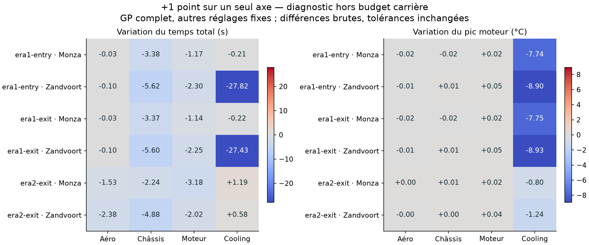
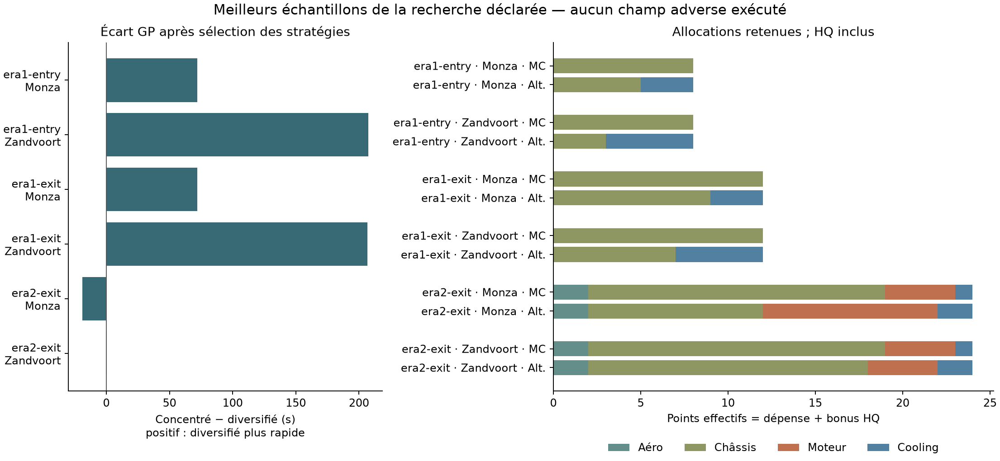

# Réponses sur GP complet : résultats et portée

Protocole, probe et règles de sélection figés avant calcul en **d124d69**.
Les équations, coefficients, catalogue v1.8.1 et tolérances restent inchangés.
[Méthode](README.md), [plan gelé](plan-v1.json),
[tableaux détaillés](MEASURED_TABLES_V1.md),
[synthèse machine](results/summary-v1.json).

**Résultat : les quatre axes sont reliés aux paramètres physiques et donnent des
réponses différentes selon la technologie et le circuit.** Le cooling peut être
très utile, marginal ou coûteux lorsque le besoin est déjà couvert. Cela ne
qualifie ni une difficulté face à neuf IA, ni une importance pratique suffisante
de chaque axe dans tous les contextes.

## Campagne exécutée

Six cohortes : entrée/sortie d'ère I et sortie d'ère II, Monza et Zandvoort,
composants réellement acquis, budget discrétionnaire8/11/16 et bonus HQ fixes.
Chaque trajectoire porte sur le GP officiel complet. Une route de doctrine est
calculée, les trois routes exportées étant des alias physiques dans ces fixtures.
Les seeds de source sont ceux de chaque circuit préparé, pas une graine unique.

| Phase | Requêtes de la phase | Nouveaux processus de calcul |
| --- | ---: | ---: |
| Allocations à curseurs fixes | 240 | 240 |
| Allocations/curseurs, dont grille concentrée complète720 | 870 | 776 |
| Un tour de transferts locaux bornés | 54 | 39 |
| Diagnostics causaux +1, hors budget | 30 | 24 |
| Recettes pneus/stands à réglage fixe | 96 | 84 |
| Confirmation fraîche des12choix finaux | 12 | 12 |
| Référence minimum-grip des mêmes choix | 12 | 12 |
| Conditions réservées | 60 | 60 |
| Répétition fraîche des conditions réservées | 60 | 60 |

**1 307 calculs natifs de GP individuels**, dont72 confirmations/répétitions,
pour1 235requêtes sémantiques,1 223enveloppes de diagnostic distinctes et
1 211entrées physiques distinctes. Les différences viennent du cache entre
phases, des stratégies source/mh50 physiquement identiques et des anticipations
minimum/reachable sur une même entrée physique. Ne pas compter ces alias ou
répétitions comme observations indépendantes.

Aucun échec de simulation ni de résolution. Aucune course omise pour améliorer
la sélection. Les confirmations des12choix et les60répétitions réservées sont
exactement identiques aux premières exécutions, dans de nouveaux processus sans
réutilisation du résultat en cache. Les autres balayages ont un passage.

## Pertinence des axes

24paires ajoutent exactement un point à un axe, avec budget autorisé augmenté
d'un point, tous les autres réglages fixes. Elles sont **hors budget carrière**,
exclues de la sélection compétitive. Pilote, bruit et configuration de calcul
restent identiques dans chaque paire. Ce ne sont pas des transferts entre deux
axes ; ils permettent de distinguer causalité et meilleur emploi d'un budget.

Les quatre axes changent leurs paramètres dans les six contextes : traînée/aéro,
efficacité de transfert des forces du châssis, courbe de couple, dimensionnement
du radiateur et traînée de refroidissement. Les champs de compatibilité encore
présents, notamment `engine.k_cool`, ne doivent pas être confondus avec la loi
thermique V2 effectivement utilisée.

Exemples **bruts**, autour de l'allocation de source à curseurs0,5/0,5 :

| Diagnostic +1 | Δ temps GP | Δ pic moteur |
| --- | ---: | ---: |
| Cooling, entrée I, Zandvoort | **−27,818 s** | **−8,904 °C** |
| Cooling, entrée I, Monza | −0,206 s | −7,737 °C |
| Cooling, sortie II, Monza | **+1,193 s** | −0,798 °C |
| Aéro, entrée I, Monza | −0,031 s | −0,017 °C |
| Aéro, sortie II, Monza | −1,533 s | environ0 °C |
| Moteur, sortie II, Monza | −3,180 s | +0,020 °C |

En sortie II de ce diagnostic, le HQ/allocations fournissent déjà5points effectifs
de cooling, et aucun derating n'est observé. Un radiateur supplémentaire refroidit
encore mais sa traînée coûte du temps. L'allocation concentrée de la comparaison
à budget fixe bénéficie, elle, déjà d'1point HQ de cooling. Ce ne sont pas les
mêmes réglages de départ.

La réponse du cooling est donc contextuelle, conformément au critère propriétaire.
Les effets de l'aéro en ère I sont **très faibles sur ces configurations de source**.
Cela confirme une connexion logicielle mais ne suffit pas à qualifier une
importance pratique pour le joueur. Plage de boîte, matériel sans aileron,
régime de fonctionnement et réponse points→physique restent à examiner avant
de modifier une loi. Ce diagnostic à curseurs fixes ne prouve pas la même faible
sensibilité à tous les réglages optimisés.

## Configurations et stratégies

Écart = temps concentré − temps alternatif, positif si l'alternative est plus
rapide. « Concentré » signifie dépense discrétionnaire moteur/châssis uniquement,
avec tous les bonus HQ conservés. L'alternative n'est pas une obligation de
dépenser sur quatre axes. Les deux colonnes distinguent les étapes : même
stratégie source, puis meilleure recette déclarée pour chaque réglage figé.

| Étape | Circuit | Écart, stratégie source fixe | Écart, recettes choisies |
| --- | --- | ---: | ---: |
| Entrée I | Monza | +78,757 s | +72,161 s |
| Entrée I | Zandvoort | +229,650 s | +207,325 s |
| Sortie I | Monza | +78,570 s | +71,907 s |
| Sortie I | Zandvoort | +229,593 s | +206,854 s |
| Sortie II | Monza | +3,476 s | **−18,910 s** |
| Sortie II | Zandvoort | −1,628 s | **−0,218 s** |

Le classement de fin II à Monza change donc après la recherche de stratégie.
Attribuer cet écart au seul cooling serait incorrect : les configurations
diffèrent aussi par le châssis, le moteur, les curseurs et leur réponse aux gommes.
La petite différence0,218s à Zandvoort n'est pas un verdict robuste de supériorité.
Les deux anticipations de frontière donnent le même ordre sur les six paires
finales ; cela n'établit pas un bornage de l'erreur numérique globale.

Dans la famille moteur/châssis, **la dépense entièrement en châssis est le meilleur
échantillon de la grille dans les six cas**. Les meilleures alternatives du début
de carrière transfèrent3à5points vers cooling. En sortie II, les choix sont
différents avec les bonus HQ. Les curseurs de boîte atteignent la borne1 dans
cinq des six meilleurs réglages concentrés. Ces observations demandent un audit
des rendements marginaux/plages autorisées ; augmenter simplement la difficulté
des IA ne changerait pas l'optimum intrinsèque du joueur.

La recette soft→medium→soft en deux arrêts est retenue dans10des12sélections,
medium→hard avec arrêt35% dans les deux autres. Les gains de stratégie dans
l'échantillon vont d'environ5,6à366s à réglage fixe. Ce sont les meilleurs choix
parmi huit recettes, pas une recherche exhaustive du plan de course. Les setups
sont sélectionnés d'abord sur la stratégie source : aucune optimalité globale
jointe allocation/curseurs/stratégie n'est revendiquée.

## Conditions réservées

Les12choix et leurs recettes sont enregistrés dans
[selection-lock-v1.json](results/selection-lock-v1.json) **avant** tout calcul
réservé. Le champ `opened_reserved_results:false` décrit cet instant de scellement,
pas l'état final de la campagne. Le contenu et son digest sont contrôlés après
validation ; aucun réglage n'est repris à partir des résultats réservés.

Deux graines314159/271828, températures air/sol20/30°C et40/50°C sur le circuit
d'origine :48cas. Les choix Monza sont aussi transférés à Silverstone (ère I)
ou Montréal (sortie II), recettes reconstruites aux distances officielles :12cas.
Ces températures sont constantes, sans modèle de pluie/météo dynamique. Les
références de ces circuits étaient déjà exposées ; leurs réponses aux setups
sélectionnés n'avaient pas servi à la sélection.

Les60cas finissent et leur répétition fraîche est exacte. Les alternatives sont
plus rapides dans20des24paires sur circuit d'origine et dans6des6paires de
transfert. Ce sont des comparaisons de deux configurations, **pas des victoires
face à un plateau IA**. Deux graines ne constituent pas une statistique de risque
d'incident. Les classements de sortie II changent avec les conditions : à Monza,
les alternatives gagnent environ56–58s à froid mais perdent50–51s à chaud.
Plusieurs paramètres diffèrent : ne pas attribuer ces inversions au cooling seul.

## Continuité, calcul et limites

Vitesse, moteur, surface, carcasse et usure : **zéro saut** entre l'état après
tour/service et le tour suivant dans le domaine exécuté. Le carburant n'a pas
de trace point à point dans ce banc ; aucun saut indépendant n'est inventé.

| Contrôle numérique | Maximum |
| --- | ---: |
| Couplage relatif adhérence | 0,000999973, tolérance inchangée0,001 |
| Borne d'utilisation du contact | 0,994288 |
| Passes de couplage | 15/24 |
| Résidu thermique moteur | 2,72×10⁻⁸ J |
| Résidu thermique pneus | 8,03×10⁻⁹ J |
| Résidu énergétique carburant | 0 J |
| Résidu bilan véhicule | 3,64×10⁻¹² J |

**10tours de Monza** dans les enveloppes de diagnostic distinctes utilisent le
recalcul conservateur prévu. À la cinquième mise à jour de borne, la règle du
solveur reprend l'ancrage conservateur, avant publication ; ces dix tours sont
certifiés ensuite. Aucun endpoint raboté, préfixe réécrit, tolérance
élargie ou échec masqué. Ces compteurs sont du travail de tentative, pas des
événements physiques à afficher à l'Engineer. Cette extension de domaine dépasse
le maximum d'1mise à jour du précédent petit écran : elle est conservée dans les
reçus et signalée à #461, sans prétention de coût navigateur/WASM/VPS.

Validation locale : deux anciens GP reproduisent exactement entrées/résultats,
tours, compteurs et continuité ; huit contrôles invalides refusés. **598tests
passent,0échec,22ignorés préexistants** avec doctests. Compilation workspace
toutes cibles, Clippy strict du nouveau probe et du périmètre CI, format/diff
passent. Intégrité des anciens reçus vérifiée. Les répétitions qualifient le
déterminisme ; elles ne prouvent ni précision physique expérimentale ni borne
sur l'erreur globale d'un faible écart de chrono.

La recherche reste partielle pour les allocations alternatives, les curseurs
continus et les stratégies. Elle ne couvre pas les ères III+, l'hybridation,
l'auto-préparation du carburant, les accidents/VSC ou l'admission dans le jeu.
Les conventions héritées100kg/90°C sont explicites et inchangées. Aucun
navigateur personnel, sauvegarde, service ou déploiement modifié.

## Suite

Conserver les coefficients et utiliser ces réponses comme base d'un **premier
champ fixe de neuf adversaires I/II**, avec stratégies et profils variés. Examiner
en parallèle les faibles rendements aéro précoces et les bornes de boîte/points,
sans imposer une dépense minimale ni amplifier le cooling. Ce pilote doit mesurer
les réponses et difficultés réelles sur calendrier, avant de qualifier un
équilibrage fin puis Worker/WASM/Authority/Verifier.

Suivi : campagne [#468](https://github.com/loicbelec/pitgun/issues/468), pilote
adversaires [#457](https://github.com/loicbelec/pitgun/issues/457), audit contextuel
des points/plages de boîte [#469](https://github.com/loicbelec/pitgun/issues/469).
