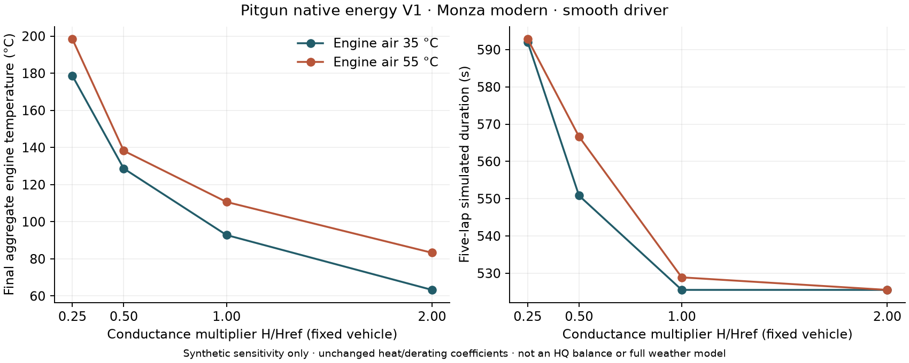

# Qualification locale — candidat travail-énergie V1

Campagne du 21 novembre 2026, macOS arm64 / Rust 1.89.0. Sources physiques figées
`6d8fcb5` ; runner et contrôles figés dans `f983369`. Le rapport identifie le commit
complet, les sources compilées, les binaires et le catalogue 1.8.1. Les résultats
physiques ne sont pas une calibration à des chronos réels.

[Rapport complet](results/local-energy-v1.json) · [SHA-256](results/local-energy-v1.sha256)

## Résultats et ancien chemin

Les dix sorties historiques **complètes et canoniques** sont identiques aux
archives du lot 0, y compris leurs digests. Les onze configurations appariées à
terminaison requise passent avec les deux modèles. Chaque mode est répété deux
fois dans des processus frais, dans l'ordre ancien/nouveau/nouveau/ancien. Les
valeurs physiques et leurs digests sont exactement répétables avec le même
binaire. La seconde campagne complète `--check` passe également sans réécrire l'archive.

Les temps de course et carburants ci-dessous concernent le joueur. Les temps de
calcul sont les médianes du cœur Solver, sommées sur **tous les concurrents** du
cas (dix pour `grid10`). L'ordre ancien → nouveau ne désigne pas une accélération.

| Cas | Durée simulée, s | Écart durée | Carburant consommé, kg | Cœur natif, ms |
| --- | ---: | ---: | ---: | ---: |
| `monza-classic-5` | 610.654 → 609.454 | -0.196% | 7.217 → 7.155 | 39.4 → 239.1 |
| `monza-classic-5-1hz` | 610.654 → 609.454 | -0.196% | 7.217 → 7.155 | 39.9 → 237.4 |
| `silverstone-classic-5` | 651.641 → 650.159 | -0.227% | 7.469 → 7.423 | 40.1 → 233.0 |
| `monaco-classic-5` | 447.508 → 446.017 | -0.333% | 4.532 → 4.476 | 21.6 → 123.0 |
| `suzuka-classic-5` | 647.481 → 645.988 | -0.231% | 7.230 → 7.192 | 39.7 → 225.0 |
| `monza-classic-53` | 6495.961 → 6499.724 | +0.058% | 75.444 → 74.878 | 421.9 → 2627.1 |
| `monza-modern-5` | 527.441 → 527.492 | +0.010% | 12.190 → 11.919 | 39.0 → 222.0 |
| `monza-hybrid-resource-5` | 486.817 → 486.012 | -0.165% | 12.471 → 12.225 | 39.8 → 257.9 |
| `monza-classic-grid10-5` | 610.654 → 609.454 | -0.196% | 7.217 → 7.155 | 403.8 → 2402.0 |
| `monaco-classic-78` | 7163.660 → 7213.183 | +0.691% | 68.521 → 67.459 | 337.8 → 1980.2 |
| `spa-classic-5-seed17` | 758.485 → 757.977 | -0.067% | 8.640 → 8.530 | 48.2 → 282.9 |

Le nouveau cœur coûte environ **5,7 à 6,5 fois** le coût ancien sur les cas qui
terminent. Cette dépense vient du calcul contraint des segments et de la fermeture
du freinage/anticipation ; l'exacte attribution par fonction reste à profiler.
Le processus complet inclut aussi résolution, historique natif, hachage et
sérialisation. Ses temps et RSS figurent dans le rapport ; ils ne sont pas le coût
d'un navigateur, d'un Worker, d'un appel Verifier ou d'une distribution dix voitures.
Deux répétitions servent à constater l'ordre de grandeur, pas à conclure à une
régression statistiquement quantifiée sur toutes les machines.

## Bilans et tests indépendants

Sur toutes les voitures et sensibilités terminées, les maxima absolus observés
sont :

- `clock_residual_s` : 0 s.
- `fuel_mass_residual_kg` : 2.975e-14 kg.
- `mass_service_boundary_residual_j` : 2.049e-08 J.
- `shaft_work_residual_j` : 3.809e-07 J.
- `thermal_storage_residual_j` : 4.796e-07 J.
- `vehicle_work_residual_j` : 3.735e-07 J.

Les limites brutes d'adhérence et les résidus par segment sont également vérifiés
selon le plan figé. Des résidus petits prouvent la cohérence comptable des équations
retenues ; ils ne prouvent pas que les coefficients ou les pneus sont réalistes.

Les tests analytiques séparés vérifient une accélération à couple constant à
1/2/5/10m de pas, le travail de pente, la croisière avec traînée, la roue libre,
le freinage, les interruptions de rapport, les limites de la thermique exponentielle
et la cohérence direct/incrémental/service. Le bilan global distingue la masse de
carburant retirée et l'énergie de l'arrêt abstrait, plutôt que masquer ces frontières.

## Refroidissement et maillage

Monza moderne cinq tours, conducteur lissé, véhicule physique fixé :

| Air moteur | Conductance × | Température finale, °C | Durée simulée, s | Temps avec puissance limitée, s |
| --- | ---: | ---: | ---: | ---: |
| 35 °C | 0.25 | 178.64 | 592.057 | 570.78 |
| 35 °C | 0.5 | 128.65 | 550.831 | 526.27 |
| 35 °C | 1.0 | 92.84 | 525.526 | 0.00 |
| 35 °C | 2.0 | 63.28 | 525.526 | 0.00 |
| 55 °C | 0.25 | 198.43 | 592.851 | 574.81 |
| 55 °C | 0.5 | 138.23 | 566.660 | 544.24 |
| 55 °C | 1.0 | 110.65 | 528.889 | 375.86 |
| 55 °C | 2.0 | 83.28 | 525.526 | 0.00 |

Le refroidissement influence bien la performance lorsqu'il évite la limitation
thermique. Au réglage de référence et à 35 °C, doubler la conductance ne fait plus
gagner de temps : le moteur est déjà hors de cette limitation. C'est un diagnostic
utile pour l'identification future, pas une preuve d'équilibrage des points HQ.
Les températures très hautes des perturbations extrêmes reflètent aussi l'ancien
plancher de puissance et l'absence de modèle de dommage moteur. Elles ne doivent
pas être présentées comme une plage de fonctionnement validée.

À Suzuka, le passage du maillage conservé à un point sur quatre donne 643.308 →
643.147 s sur cinq tours, soit environ −0.025 %. Ce sous-échantillonnage de géométrie
existante et ce conducteur sans bruit de contrôle **ne constituent pas** une étude
de convergence indépendante ou une recommandation de changer la télémétrie du jeu.
Les coefficients et les constantes d'air ambiant pneus/moteur restent distincts ;
il n'y a pas encore de météo cohérente.

## Échec conservé et critères de livraison

Le cas supplémentaire Barcelone 66 tours / moderne / 110 kg échoue : panne au tour 62 dans le
modèle historique et au tour 63 dans le candidat. Les erreurs sont conservées,
sans temps final ni classement fabriqués. Ce cas met en évidence la nécessité
d'identifier consommation, réservoir et stratégie sur distance complète. Ce n'est
pas la reproduction de #445, dont la requête et le seed initiaux manquent.

Avant toute admission dans le jeu : profiler/réduire le coût du nouveau noyau,
qualifier les changements de conduite, définir son export versionné, construire
un nouveau runtime WASM et vérifier son replay indépendant. Les anciens artefacts
restent nécessaires aux preuves passées. Le modèle de pneus, les coefficients de
refroidissement/aéro, le couplage à quatre passes et l'hybridation restent ouverts.
Le framework générique ne reçoit aucune règle automobile supplémentaire.

## Reçu final

[Reçu natif](results/native-receipt-v1.json) :221 tests natifs et14 contrôles Python
passent, dont15 nouveaux tests Rust physiques/audit et4 contrôles du nouveau banc.
Clippy strict passe sur les quatre bibliothèques et le nouveau probe ; rustfmt
passe sur le workspace. Les cinq warnings préexistants des anciennes cibles de
test ne sont pas masqués par une affirmation de Clippy toutes cibles. Solver et
Simulator compilent pour WASM. Il n'y a pas de nouvel artefact WASM livré, de
recette navigateur du candidat, ni d'admission signée/Verifier de cette physique.

Suivi : [lot physique446](https://github.com/loicbelec/pitgun/issues/446),
[profilage447](https://github.com/loicbelec/pitgun/issues/447). Les futures étapes
devront choisir leur précision et leur coût sur des preuves distinctes de cette
qualification comptable.
