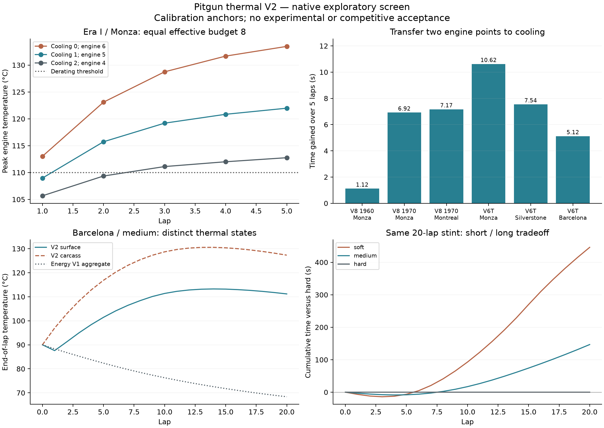

# Résultats du candidat thermique V2

Source physique : `dba 2888`. Profil : `profile-v1.json`, exploratoire. Catalogue
immuable 1.8.1 ; entrées de carrière V9 résolues, puis candidat natif explicitement
sélectionné. **REFINE** : mécanismes implémentés et répétables, pas d'admission
jeu/WASM/Verifier ni de validation expérimentale ou d'équilibrage global.

## Qualification et compatibilité

- 236 tests natifs passent : Authority 30, Simulator 114, Solver 20 unitaires et
  50 intégration, Verifier 16 bibliothèque et 6 service.
- Les 9 nouveaux tests unitaires couvrent bilan chimique/ralenti, thermostat,
  équilibre thermique, conservation, solution analytique de relaxation,
  raffinement temporel, échauffement/refroidissement et usure.
- Les 5 nouveaux tests d'intégration couvrent état incrémental/service, pertes
  mécaniques payant la chaleur, entrées invalides, commandes de gommes non résolues
  et omission des nouveaux champs historiques. Ils vérifient aussi qu'un tour
  convergé est commis exactement une fois, avec le bon nombre de tours.
- Clippy strict passe sur la bibliothèque Solver et le nouveau probe ; `cargo fmt`
  et `git diff --check` passent. Le Clippy strict du fichier d'intégration entier
  rencontre quatre anciens `field_reassign_with_default`, sans modification liée
  à ces avertissements. Les tests d'intégration eux-mêmes passent.
- Chaque campagne commence par 22 sorties/erreurs historiques gelées comparées
  exactement. Ce précontrôle passe deux fois. Les 112 nouvelles sorties (56 cas×2
  noyaux) sont ensuite toutes répétées exactement, hors mesures de processus.
  Cela fait 268 exécutions natives, précontrôles compris.
- 54 succès et 2 échecs carburant par noyau. Aucun échec de convergence dans ce plan.
  Les sources compilées, binaire, profil, requêtes et catalogue sont contrôlés ;
  le rapport 3.2 MiB et son SHA256 sont archivés dans `results/`.

Les plus grands résidus locaux du V2 sont inférieurs à10⁻⁸J pour les deux bilans
thermiques. Cela contrôle la comptabilité numérique, pas la justesse des
paramètres physiques. Le maximum de passes de couplage observé est 10 sur 24 permises.
La borne de sollicitation réelle du contact culmine à1.0001823, sous la tolérance
déclarée 1.0002 ; elle ne prouve pas une égalité physique exacte à1.

## Refroidissement et derating

Le tableau transfère deux points moteur au cooling, avec le même budget effectif,
les autres points et sliders inchangés. Ce sont des lignes de réponse exposées,
pas une recherche de tous les réglages ni une sauvegarde HQ gagnable démontrée.

| Cas,5 tours | Budget | Temps,cooling 0 | Temps,cooling 2 | Gain |
| --- | ---: | ---: | ---: | ---: |
| V8 1960,Monza | 8 | 803.745 s | 802.629 s | 1.116 s |
| V8 1970,Monza | 15 | 619.444 s | 612.524 s | 6.920 s |
| V8 1970,Montreal | 15 | 508.983 s | 501.816 s | 7.167 s |
| V6 T,Monza | 20 | 534.958 s | 524.337 s | 10.621 s |
| V6 T,Silverstone | 20 | 575.233 s | 567.690 s | 7.543 s |
| V6 T,Barcelona | 20 | 478.664 s | 473.549 s | 5.115 s |

En ère I, le pic passe 133.48→112.76°C et le minimum de puissance disponible
90.61→98.90%. Le derating agit réellement, mais son effet chronométrique reste
**modeste** dans cette configuration : sa désactivation seule à cooling 0 gagne
1.349 s. Réduction de puissance disponible et réduction du travail effectivement
demandé ne sont pas identiques : une marge de couple, l'adhérence ou le régime
maximal peuvent limiter l'effet sur la vitesse. Ne pas présenter ces chiffres
comme la preuve qu'un joueur ne peut jamais ignorer le cooling. Il faut encore
éprouver les allocations/sliders, bonus HQ et conditions précoces réellement joués.

Clarification gameplay du propriétaire après lecture : **ce gain modeste sur cinq
tours dans les premières ères correspond au comportement recherché**. Le cooling
doit être perceptible et pédagogique, sans pénaliser fortement les premiers
réglages. Ne pas amplifier le derating ou le gain chronométrique dans le seul but
de rendre ce cas plus spectaculaire. La validation des autres configurations,
conditions et distances reste nécessaire ; ce choix ne vaut pas acceptation de
l'ensemble du candidat physique.

La comparaison à moteur inchangé,cooling 0→2, donne 802.425 s au prix d'un budget
augmenté : c'est un diagnostic causal distinct du tableau à budget égal. Les
seuils de protection restent ceux du catalogue ; le dimensionnement de radiateur
et la source de chaleur ont changé, avec des paramètres provisoires déclarés.

Le maximum de cooling n'est pas systématiquement meilleur. À Montreal,budget 15,
cooling 4 fait 502.608 s contre 501.816 s pour cooling 2 ; à Monza,V6 T,cooling 6 fait
525.126 s contre 524.337 s pour cooling 2. L'opportunité des points et la traînée font
partie de la résolution ; aucune règle cachée ne taxe spécifiquement le zéro.

Sur les 53 tours V8 1970/Monza, même transfert 0→2 :6669.291→6599.890 s, soit 69.401 s
gagnées. Les deux runs terminent à100 kg initiaux, avec un arrêt déclaré au tour 26.
Ce n'est pas une validation de toutes les courses/ères ou du meilleur plan d'arrêt.

## Pneus et réglages

Barcelona,medium,20 tours,initial 90°C : la surface finit 111.17°C et la carcasse
127.30°C. L'ancien candidat énergie finit environ 68.37°C sur son unique état.
Le V2 chauffe sur 52% du temps de roulage et refroidit sur 48%, sans règle imposant
une hausse monotone. Le départ froid 35°C mène à108.66°C de surface en fin de relais :
le modèle sait aussi échauffer un pneu froid. Ce ne sont pas des températures
mesurées de pneus réels ; la répartition des flux et des températures reste à valider.

La gomme possède ses capacités, fenêtre de grip et énergie d'usure. Sur le même
relais 20 tours, les trois premiers tours donnent :

| Gomme | Temps des 3 premiers tours | Temps 20 tours | Usure finale |
| --- | ---: | ---: | ---: |
| Soft | 277.599 s | 2483.171 s | 100% |
| Medium | 283.962 s | 2183.819 s | 78.70% |
| Hard | 291.644 s | 2037.092 s | 51.82% |

L'avantage initial des softs existe désormais dans cet ancrage ; leur surchauffe,
usure et pertes de grip les pénalisent ensuite. Le hard domine encore ce relais
long sans arrêt. Parmi les plans medium→soft testés, le tour 15 reste le meilleur
arrêt échantillonné (2054.576 s), devant 10 (2061.531 s) et 5 (2244.054 s). L'ancienne
préférence pour les arrêts tardifs n'est donc **pas déclarée résolue**. Ces relais
de 20 tours ne sont pas des Grands Prix réglementaires complets comparables au leaderboard.

Changer le downforce 0.2→0.8 dans le cas setup/Barcelona 5 tours change la surface
finale 99.66→102.62°C et le temps 480.029→471.045 s. Les profils physiques
`franz_hermann`/`battery_voltas` modifient aussi temps/température/usure ; leurs IDs
modifient le bruit déterministe, ce ne sont pas des ablations pures d'un seul
curseur d'agressivité. Ces sensibilités ne démontrent pas l'équilibre de chaque
axe ni un meilleur comportement universel de conduite.

## Échecs et coût

Les quatre échecs archivés sont les deux configurations V6 T/Monza 53 tours, exécutées
dans chaque noyau. Le V1 énergie épuise le carburant au tour 44 ; le V2 au tour 50
(cooling 0) ou 49 (cooling 2). Pas de réservoir augmenté, d'erreur masquée ou de
projection d'une arrivée depuis un préfixe. L'hybridation et la consommation
nécessitent une décision physique explicite (#445/#246).

Mesures du **processus complet de banc**, non isolées d'autres tests locaux :
médiane des succès 508.8→706.9 ms ; maximum RSS395.8→437.1 MiB. Résolution, simulation,
digest, historique natif et statistiques sont inclus. Les trajectoires et nombres
de passes diffèrent : ce n'est ni une comparaison à sorties égales, ni une mesure
du seul noyau, du Worker/WASM ou du VPS. Aucune acceptation de performance navigateur
ne découle de ce screen. La boucle de couplage, le passage de ligne conservateur,
la conservation bornée des données et les futures cadences d'observation restent
des axes de qualification/optimisation ; aucune réduction de fréquence n'a été
effectuée ici.

## Verdict et prochaine étape

Les nouvelles lois sont effectivement codées et raccordées, les états et bilans
voyagent avec les tours et les résultats sont reproductibles. La compatibilité
historique est conservée. Les références justifient une structure de modèle ;
les coefficients de Pitgun restent des hypothèses exploratoires.

Avant Worker/WASM : réservations de validation avant tout nouveau choix de
coefficients, recherche des réglages et conditions précoces, stratégies légales et
distances complètes, meilleure anticipation/couplage et mesure de coût isolée,
échelle d'usure et comparaison aux données disponibles. Les points #420/#421
restent en cours. Ni ce rapport ni la répétabilité ne valent validation industrielle.
